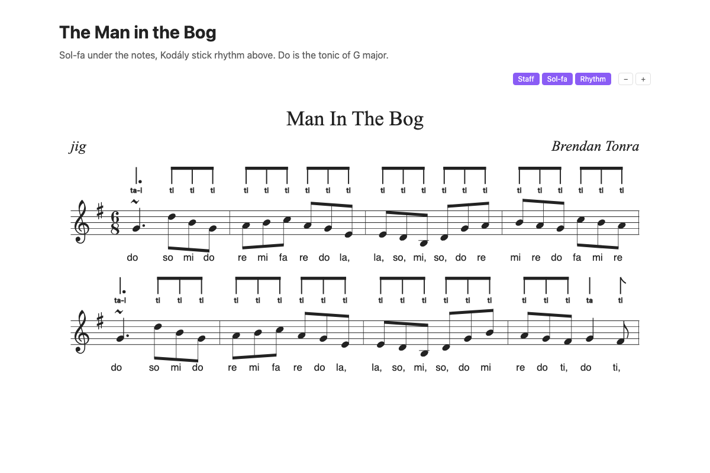
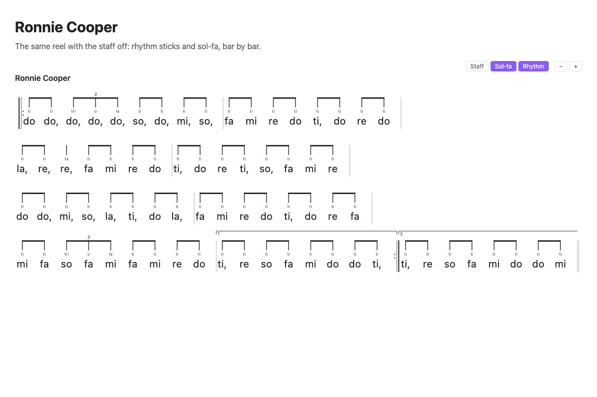

# ABC Sol-fa

An Obsidian plugin that renders ABC tunes and adds Kodály teaching layers: sol-fa syllables under the notes, and stick rhythm notation above them.



It shows `abc-solfa` blocks, so it works alongside other ABC plugins that show plain `abc` blocks. To use it for your existing `abc` blocks as well, without changing your notes, set "Code blocks to show" to "Both abc and abc-solfa" in the settings, turn off any other ABC plugin (only one plugin can show `abc` blocks) and reload Obsidian.


## Usage

````
```abc-solfa
X: 1
T: The Man in the Bog
M: 6/8
L: 1/8
K: Gmaj
~G3 dBG|ABc AGE|EDB, DGA|BAG cBA|
```
````

Each block has buttons for Staff, Sol-fa and Rhythm. A button changes that block until the note is reloaded. To set a block permanently, add options to the fence line:

````
```abc-solfa solfa=off
````

Options are `staff`, `solfa` and `sticks` (or `rhythm`), each `on` or `off`, `group=` for the beat grouping (see Beat grouping below) and `tempo=` for the playing speed (see Playback). Anything not set on the fence uses the plugin settings.

With the staff off, the sticks and sol-fa are laid out on their own, bar by bar, with the tune's line breaks.



The - and + buttons make the sol-fa and rhythm sticks smaller or larger together, from 75% to 200%. The size is saved and applies to every block, and is also "Overall size" in the settings. With the staff off, the sol-fa is shown larger than the rhythm syllables (twice the size by default); "Sol-fa compared with rhythm" in the settings changes this. Under the staff the sol-fa has to fit between the notes, so it follows the overall size only.

## Playback

The Play button plays the tune, and Stop stops it. Starting one tune stops any other that is playing. As it plays, the note sounding is lit up on the staff, in the sol-fa and in the rhythm sticks, so you can follow along.

The tempo comes from the tune's `Q:` line. A tune without one plays at a learning pace: 100 quarter notes a minute, or 72 dotted quarters in 6/8, 9/8 and 12/8. To set the tempo for one block, add `tempo=` to the fence line, in beats a minute (dotted quarters in compound meters, otherwise quarters):

````
```abc-solfa tempo=80
````

The speed menu next to Play slows the tune to 75% or 50%, or speeds it up to 125%, until the note is reloaded.

The sounds are recordings of real instruments (piano by default; harp, nylon guitar and flute in the settings under "Instrument"), not synthesised beeps. Chord symbols in the tune are not played.

Network use: the instrument recordings are downloaded from [midi-js-soundfonts](https://github.com/paulrosen/midi-js-soundfonts) on GitHub Pages, a note at a time, the first time each note is played. Nothing else is sent. Without an internet connection, playback shows a message instead of playing.

## Paper

By default the tune is drawn as black ink on cream paper (the cream thesession.org uses), in light and dark themes alike. "Paper" in the settings switches to white paper, or to Follow theme, which draws the tune in the theme's text colour on the note background.

## Sol-fa

Movable do. By default do is the major tonic of the key signature, as in Kodály teaching: minor tunes are la-based, Dorian tunes re-based and Mixolydian tunes so-based. In the settings you can put do on the tune's home note instead.

Accidentals use chromatic syllables: raised notes take di, ri, fi, si, li and lowered notes take ra, me, se, le, ta (lowered ti is ta, as in British Kodály practice). An accidental lasts to the end of the bar.

Syllables can be shown as words (do re mi) or letters (d r m). Octave marks show notes above the main octave as d' and below it as l,.

Notes:
- Only the first voice of a tune gets syllables.
- If a tune already has `w:` lyrics, they stay and the sol-fa appears as an extra verse below them.
- Tied notes take one syllable.

## Development

```bash
npm install
npm test
npm run build
node scripts/install-plugin.mjs "/path/to/vault"
```

## Printing

When a note is printed or exported to PDF, the buttons are left out and only the tune is shown.

## Licence

MIT. Includes [abcjs](https://github.com/paulrosen/abcjs) (MIT).

## Rhythm sticks

Kodály stick notation with rhythm syllables, drawn above the staff. Simple meters (2/4, 3/4, 4/4, and 2/2 counted in quarters) use ta, ti-ti, tika-tika, ti-tika, tika-ti, ta-a and ta-i ti. Compound meters (6/8, 9/8, 12/8) count dotted-quarter beats: ta-i, ti-ti-ti, ta ti, ti ta, tika-ti-ti and so on. Rests are drawn as rest signs.

The rhythm syllables can be turned off in the settings (Rhythm syllables) to show the sticks alone.

Tied notes are joined by an arc over the sticks, and the held note has no syllable of its own. A tie over a line break shows half an arc at the end of one line and the start of the next.

A pickup bar is counted back from the bar line, so its notes fall on the last beats of the bar. This also applies to a pickup into a new part after a double bar or repeat sign. First and second endings are counted from their start.

Repeat signs and first and second ending brackets are shown with the sticks. With the staff on they sit at the same places as on the staff.

An eighth-note triplet filling a beat is tri-o-la, beamed with a 3 above. Sixteenth-note triplets (tri-o-la in half a beat) and quarter-note triplets (tri-o-la over two beats, with a bracket) work the same way. Other tuplets, such as duplets in 6/8 or groups of 5, are drawn with their sticks, beams and number but no syllables. A beat the plugin cannot name shows plain sticks and a "?".

### Beat grouping

Each meter has a usual grouping: 6/8 in two dotted-quarter beats, 9/8 in three, 4/4 in four quarters, 7/8 as 2+2+3 and 5/8 as 3+2, and so on. To group the beats another way, add `group=` to the fence line:

````
```abc-solfa group=2+2+3
X: 1
M: 7/8
L: 1/8
K: Am
A2B2 c3|ABcd e2c|
```
````

The numbers count the meter's note value (eighths in 7/8 or 9/8, quarters in 4/4). They can also count in eighths in a quarter-note meter when that is what fills the bar, so `group=3+3+2` works in 4/4. If the numbers do not add up to a bar, the block says so and uses the usual grouping.

If the sticks cannot be lined up with the staff (abcjs laid the tune out differently from how the plugin read it), the block says so; turn the staff off to see the sticks on their own.
